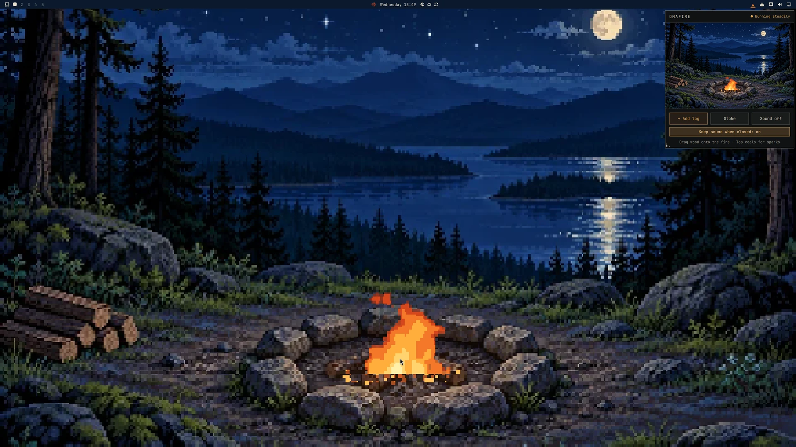
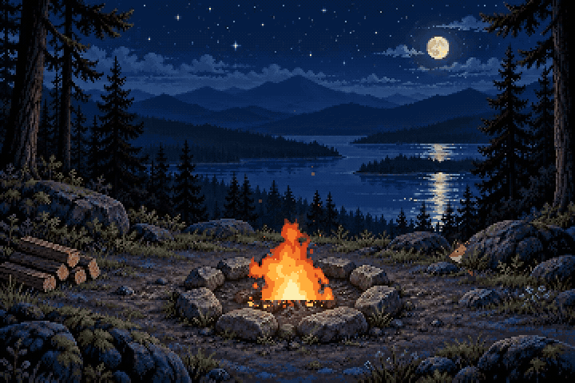

# OmaFire

This fork of [Wes Grimes's OmaFire](https://github.com/wesleygrimes/omafire) adds an interactive desktop wallpaper sharing the widget's live fire, plus optional background ambience when the popup is closed. The original quiet-by-default behavior is unchanged.

A tiny campfire for your Omarchy bar.

Click the flame in the bar and a little campsite opens up. Throw a log on, stoke it, poke the coals, then go back to work and let it burn down on its own. It doesn't track anything, doesn't nag you, and won't tell you how productive you were.


```bash
omarchy plugin add https://github.com/Pillumz/omafire --enable
```

That's the whole install. The fire is in the right side of your bar.


## What you can do with it

- **Add a log.** Click **+ Add log**, or drag one from the woodpile at the lower left and drop it on the fire. One log is about three more minutes of fire.
- **Stoke it.** **Stoke** makes it flare up for a bit. It doesn't add wood, so stoking an empty fire pit just gets you a polite note.
- **Poke the coals.** Click the coals for a shower of sparks. Very satisfying, no practical value.
- **Watch for a visitor.** A red fox occasionally slips out from behind the right-hand rocks, listens, noses around the clearing and sits for a quiet moment by the fire. Its ears twitch, its brush tail sways, and moonlight catches its russet coat. Click near it and it rises, turns and bounds back to cover. It shares the same visit across the popup and wallpaper, and never needs feeding or attention.
- **Listen to it.** **Sound on** plays the fire. It follows the fire: a low fire is soft embers, a steady one crackles, a hot or stoked one roars, and adding a log or stoking has its own sound. With the sound on, crickets chirp in short phrases from off in the trees, and a frog calls now and then. Both stay soft, as if they were across the water.
- **Keep the ambience.** Turn **Keep sound when closed** on to let the fire, crickets and frogs keep playing after you close the popup. Turn **Sound off** to silence everything. Background sound defaults to off; its preference is remembered, but sound itself always starts off after a shell restart or login. Closing the popup stops its scene animation; an active live wallpaper keeps animating.
- **Leave it alone.** A full load burns for about 13 minutes, down to glowing embers, then coals, then rest. It keeps burning while the popup is closed, and after a restart or a suspend it picks up where it would have been.

The bar icon is a little pixel fire that follows along, so you can tell at a glance whether it needs a log. Hover it for the status.


### Keys

While the popup is open: `A` adds a log, `S` stokes, `M` toggles sound, `Tab` moves between the buttons, `Esc` closes it.

### Keybind and scripts

OmaFire answers on the shell IPC target `wesleygrimes.omafire`:

```bash
omarchy-shell wesleygrimes.omafire toggle
omarchy-shell wesleygrimes.omafire addLog
omarchy-shell wesleygrimes.omafire status
```

The functions are `toggle`, `open`, `close`, `addLog`, `stoke`, `poke`, `sound`, `backgroundSound`, and `status`. `sound` toggles playback; `backgroundSound` toggles whether sound may continue with the popup closed. `status` prints JSON with fuel, heat, boost, status, open, wallpaper, sound, backgroundSound, and audioPlaying.

To open it from the keyboard, add a binding to `~/.config/hypr/bindings.lua`:

```lua
o.bind("SUPER + ALT + O", "OmaFire", "omarchy-shell wesleygrimes.omafire toggle")
```

`SUPER + ALT + O` is free on a stock Omarchy 4 install. Check `omarchy-menu-keybindings --print` if you've moved things around.

## Interactive desktop wallpaper



Install the original [Campfire theme](https://github.com/piermark/omarchy-campfire-theme)
alongside this plugin. No theme fork or changes to its files are needed:

```bash
omarchy theme install https://github.com/piermark/omarchy-campfire-theme
```

With that theme selected, the desktop and popup show the
same live fire: wood added in either view feeds both, and the fire really burns
down and goes out unless you tend it.

On the exposed desktop, drag a log from the woodpile onto the fire, or click the
coals for sparks. Normal windows stay above it and it never takes keyboard focus.
Desktop double-clicks do not open the wallpaper or theme picker while the live
scene is active. Use **Super+Space** to open Omarchy's menu and change themes.
Clicks near a visiting fox spook it; other clicks outside the woodpile and coals do nothing.

The scene fills each screen without stretching, cropping equally at opposite
edges. Wide or tall screens may crop useful parts of the artwork. There are no
desktop buttons or extra shortcuts: use the widget for stoking and sound. Audio
remains off at login; **Keep sound when closed** controls whether it continues
when only the wallpaper is showing.

Switching to another theme removes the live layer and reveals the normal
wallpaper. No changes to Omarchy or Hyprland, no video player, and no additional
process. Desktop mode uses the current Omarchy 4.5 theme staging layout; the
widget still supports Omarchy 4.0.

OmaFire activates the desktop scene when the active theme is named `campfire`.
Other themes, including a renamed copy of Campfire, keep their normal wallpaper.
Without this plugin, the original Campfire theme uses its ordinary still image.
Do not run the theme\'s optional `extras/install-live`: that starts a separate
recorded video, not the shared interactive fire.

The animation currently runs even behind covering windows. It keeps the existing
360 by 240 pixel buffer and 20 fps drawing rate; opening the popup or adding
monitors adds another view, not another simulation. It does not guarantee that
different screens present the same frame at exactly the same instant.

### Replacing the old video wallpaper

If you previously used the theme\'s video helper, stop and remove its user-level
setup before using OmaFire\'s desktop scene:

```bash
systemctl --user stop campfire-live.service 2>/dev/null || true
rm -f ~/.config/omarchy/hooks/theme-set.d/campfire-live \\
      ~/.config/autostart/campfire-live.desktop \\
      ~/.config/systemd/user/campfire-live.service \\
      ~/.config/omarchy/campfire-live.conf
systemctl --user daemon-reload
```

If you copied the old recording into additional wallpapers, remove that copy too
so it does not appear as a second, non-interactive Campfire choice:

```bash
rm -f ~/.config/omarchy/backgrounds/campfire/02-campfire-live.mp4
```

This does not uninstall `mpvpaper` or stop unrelated players. Very old helper
installations also added a `campfire-live` line to Hyprland\'s autostart file;
remove that old entry if you still have one.

## Requirements

- Omarchy 4.0 or newer with the Quickshell bar. Tested against Omarchy 4.0.6 and the 4.5 dev build, with Quickshell 0.3.2, Qt 6.12, and Hyprland 0.57.
- On Omarchy 4.0.x, OmaFire ignores the reduce motion setting, since 4.0.x doesn't have one, and `omarchy-shell` calls go through `qs ipc`, so they're a little slower than on 4.5. Everything else is the same.
- `qt6-imageformats` to load the WebP artwork.
- `qt6-multimedia` for the sound. It's optional. Without it everything else works and the Sound button says sound isn't available.

Install either with `sudo pacman -S qt6-imageformats qt6-multimedia` if they're missing.

No network access, no web view, no extra background process. It's plain QML and JavaScript running inside the shell you already have.

### If it doesn't show up

Check that it's installed and enabled, then look for OmaFire in the shell log:

```bash
omarchy-version
omarchy plugin list | grep -i fire
quickshell log -p /usr/share/omarchy/shell -n | grep -i -E 'omafire|FireSession|OmaFireBar'
```

Please open an issue with that output if the fire still isn't in your bar.

## Remove it

Turn it off and keep it installed:

```bash
omarchy plugin disable wesleygrimes.omafire
```

Remove it completely:

```bash
omarchy plugin remove wesleygrimes.omafire --yes
rm -rf ~/.local/state/omafire
```

The second line deletes the saved fire (fuel and heat), panel size and background-sound preference. OmaFire doesn't write anywhere else.

### Manual install

If you'd rather not use `omarchy plugin add`:

```bash
git clone https://github.com/Pillumz/omafire ~/.config/omarchy/plugins/wesleygrimes.omafire
omarchy-shell shell rescanPlugins
omarchy plugin enable wesleygrimes.omafire
```

Remove a manual install with `omarchy plugin disable wesleygrimes.omafire`, then delete that folder.

## How it works

The fire started life as a small browser prototype. OmaFire ports its drawing code into QML: the same noise, palette, sparks, smoke, light, and timing, drawn into a 360 by 240 pixel buffer and scaled up without smoothing so it stays crisp on HiDPI screens. The lake adds gently rippling moonlight and silver-blue glints. The tests check that the fire produces the same pixels as the original, frame for frame, and that the lake animation stays on the water.

Each view draws only while active, and copies only the parts of the picture that changed. Without a live wallpaper, it only draws while the popup is open. With the popup closed the cost is the bar icon, which is about 1% of one core on my VM. With it open it's roughly a fifth of one core, which is about what a small animated campfire should cost you.

State lives in `~/.local/state/omafire/state.json` (or under `$XDG_STATE_HOME`). Sound is never saved. The background-sound preference is remembered in `panel.json` beside that file. Drag the lower-left corner to resize the panel; its width is remembered there too, and the next open uses it. The scene stays 3:2.

The fox is articulated pixel art with sixteen-frame walking, sniffing, sitting, turning and bounding animations. Planted paws and a soft contact shadow give it weight; its layered coat catches cool moonlight and warmer, flickering light from the hearth. Its first visit comes after roughly 45–100 seconds of active scene time, with 2½–6 minute quiet gaps between visits. Visits stop when neither scene is active, and a suspend dismisses the current visitor rather than replaying missed encounters. No extra timer, process or saved animal state.



More detail, including the numbers, is in [docs/NOTES.md](docs/NOTES.md).

## Development

```bash
mise run test
```

That runs the simulation tests, a pixel comparison against the original prototype (in Node and in headless Chromium), offscreen QML tests at 1x and 2x, a Quickshell integration run, and `omarchy plugin validate`. Images land in `tests/out/`.

The [same-process reload check](docs/RELOADS.md) is a separate, VM-only workflow. It exercises the real shell through 20 full plugin reloads, checking that its process stays responsive and the wallpaper and bar recover. It is deliberately not run against your desktop by the regular suite.

`mise run sound` rebuilds the fire sounds (`assets/fire-*.wav`) from `scripts/gen-fire.py`, and the cricket and frog calls from `scripts/gen-night.py`.

## Credits

The campsite artwork in `assets/campsite-approved.webp` was made for this project and ships unchanged. The fire sounds are generated by `scripts/gen-fire.py`. The cricket and the two frog calls are generated by `scripts/gen-night.py`.

## Contributors

Thanks to these people ([emoji key](https://allcontributors.org/docs/en/emoji-key)):

<a id="maintenance-wesleygrimes"></a>

<!-- ALL-CONTRIBUTORS-LIST:START - Do not remove or modify this section -->
<!-- prettier-ignore-start -->
<!-- markdownlint-disable -->
<table>
  <tbody>
    <tr>
      <td align="center" valign="top" width="14.28%"><a href="https://github.com/wesleygrimes"><br /><sub><b>Wes Grimes</b></sub></a><br /><a href="https://github.com/wesleygrimes/omafire/commits?author=wesleygrimes" title="Code">💻</a> <a href="https://github.com/wesleygrimes/omafire/commits?author=wesleygrimes" title="Documentation">📖</a> <a href="#maintenance-wesleygrimes" title="Maintenance">🚧</a></td>
      <td align="center" valign="top" width="14.28%"><a href="http://www.inmattsmind.com"><br /><sub><b>Matthew L. Wolfgang</b></sub></a><br /><a href="https://github.com/wesleygrimes/omafire/commits?author=mattwolfgang" title="Code">💻</a> <a href="https://github.com/wesleygrimes/omafire/commits?author=mattwolfgang" title="Documentation">📖</a></td>
      <td align="center" valign="top" width="14.28%"><a href="https://github.com/Gobbledegookie"><br /><sub><b>Gobbledegookie</b></sub></a><br /><a href="https://github.com/wesleygrimes/omafire/commits?author=Gobbledegookie" title="Code">💻</a></td>
      <td align="center" valign="top" width="14.28%"><a href="https://promisemeforever.com"><br /><sub><b>Joseph</b></sub></a><br /><a href="https://github.com/wesleygrimes/omafire/commits?author=calledtoconstruct" title="Code">💻</a></td>
    </tr>
  </tbody>
</table>

<!-- markdownlint-restore -->
<!-- prettier-ignore-end -->

<!-- ALL-CONTRIBUTORS-LIST:END -->

This project follows the [all-contributors](https://allcontributors.org) specification.
To contribute, see [CONTRIBUTING.md](CONTRIBUTING.md).

## Support

OmaFire is free. If it's useful, you can [sponsor the work](https://github.com/sponsors/wesleygrimes) or [buy me a coffee](https://buymeacoffee.com/ncfrontiersman).

## License

MIT. See [LICENSE](LICENSE).
