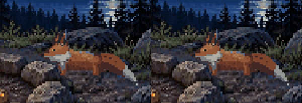
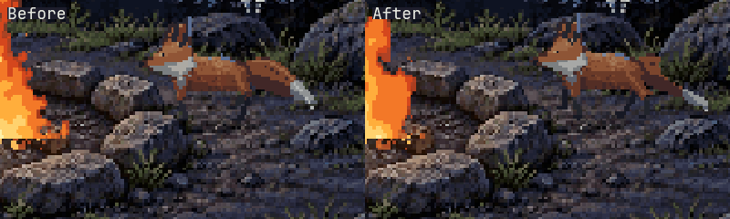
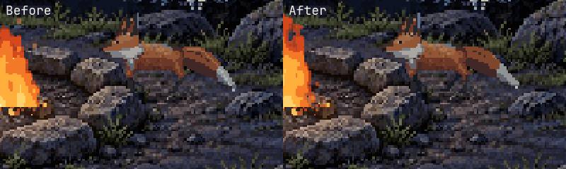
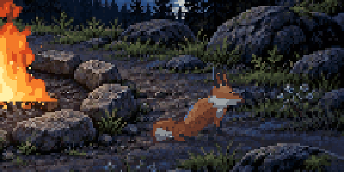
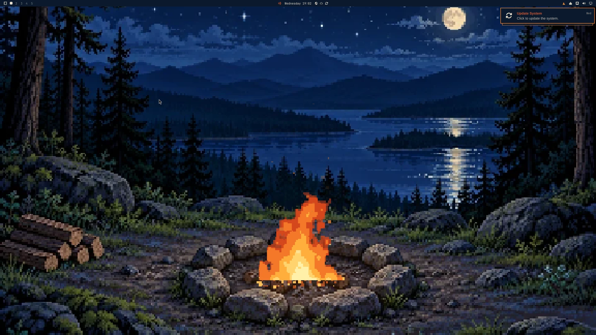
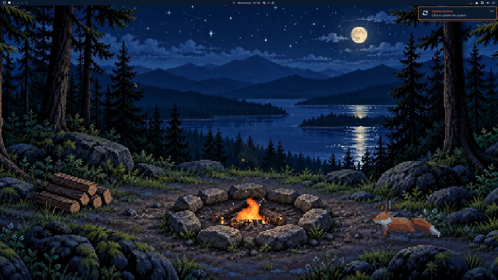
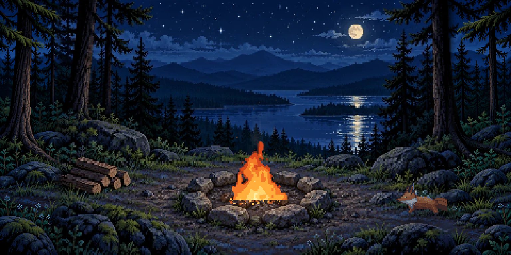
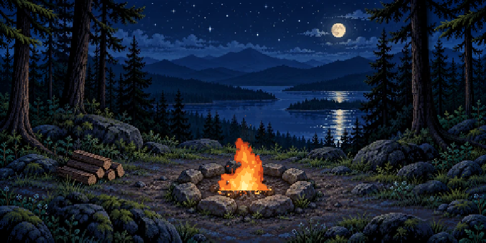
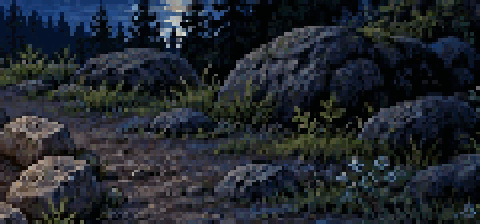

# OmaFire implementation notes

Target checked on 2026-10-31: Omarchy 4.0.0 (Quattro), Quickshell 0.3.2, Qt 6.12.0, Hyprland 0.57, HEADLESS-1 at 3456x2160 scale 2, bar on top.

## Layout

```
manifest.json            bar-widget, entry ui/OmaFireBar.qml
ui/OmaFireBar.qml        host integration: BarWidget + BarIconButton + KeyboardPanel
ui/FireSession.qml       singleton: one fire for all monitors, state file, IPC
ui/FireWallpaper.qml     service: theme opt-in, desktop layer and wide framing
ui/qmldir                singleton FireSession, OmaFireBar
ui/fire/                 plain QtQuick, no qs.* imports (renders standalone)
  fire.js                simulation + software renderer (.pragma library, node-loadable)
  panel.js               popup width, 3:2 height, corner-drag projection
  sound.js               fire layer gains from heat and boost
  night.js               cricket and frog scheduling
  wildlife.js            shared fox encounters, safe-link travel and startle
  fox-rig.js             continuous anatomy, planted paws and pose transitions
  fox.js                 pixel rasterization, contact shadow and rock occlusion
  FireState.qml          bindable wrapper around fire.js state, timers, sound toggle
  FirePopup.qml          header, scene, footer, keys
  FireScene.qml          Canvas, pointer input, toast
  FireButton.qml         footer button
  FireIcon.qml           12 x 12 bar campfire
  FireAudio.qml          QtMultimedia, created on first Sound press only
assets/                  campsite-approved.webp (unchanged), campsite-wide.webp, generated sounds
scripts/gen-fire.py      fire layers and one-shots (deterministic)
scripts/gen-night.py     cricket and frog calls (deterministic)
scripts/measure.js       CPU/RSS measurement in a live Wayland session
tests/                   see "Tests"
```

The host-independent components live in `ui/fire/` because a qmldir that declares a singleton importing `Quickshell` makes the engine resolve it when any sibling type is compiled, which broke standalone loading.

## Host integration contract (as found)

- `PluginRegistry.validateManifest` requires `schemaVersion: 1`, `id`, `name`, `version`, `kinds`, `entryPoints`; entry points must be relative with no `..`; `barWidget.defaultSection` must be one of `left`, `centerBegin`, `center`, `centerEnd`, `tray`, `right`. No category validation; first-party categories seen: Status, AI, Compositor, Audio, Layout, System, Network, Time, Files, Info, Media. OmaFire uses `Info`.
- The bar injects `bar`, `moduleName`, `settings`, `fixedEdge` into the widget (`qs.Ui/BarWidget`).
- Popup: `qs.Ui/KeyboardPanel` (a full-screen layer-shell PanelWindow, card placed inside). It handles top/bottom/left/right bars, clamps the card to the output with `Style.gapsOut` margins, dismisses on outside click (including other outputs), primes keyboard focus, and coordinates with `bar.requestPopout/releasePopout`. When another popup takes over, the bar calls `owner.closeForPopoutSwitch()`. OmaFire sets `padding: 0`, `borderSpec: Border.none()`, and draws its own border and square corners over the host card, so the themed card color and corner radius never show. `contentWidth` / `contentHeight` follow `panel.js` (default 390 x 417). The lower-left grip sets the width; the scene stays 3:2, so the height follows. The host centers the card on the icon and eases `drawnHeight` over 200 ms once the panel is open, so a drag turns that ease off (`heightLive = false`) and projects the pointer onto the corner's path (`-1/2` in x, `+2/3` in y per width pixel, or the slope measured once the card hits the screen). Width clamps to 300–960.
- Palette: the default look is the reference's fixed colors, so `Commons.Color` is not used. `Style.reduceMotion` is read for reduced motion.
- IPC: on Omarchy 4.5, `ShellIpc` from `qs.Commons` (an `IpcHandler` that `omarchy-shell` can also answer over the shell's socket), in `ui/FireIpcShell.qml`. 4.0.x has no `ShellIpc`, so `FireSession` creates that file at runtime and falls back to `ui/FireIpcPlain.qml`, a bare `IpcHandler` that `qs ipc` reaches (4.0.x's `omarchy-shell` uses `qs ipc`). Both files hold the same calls. It lives in the singleton, so there is one handler no matter how many bars exist.
- Omarchy 4.0.x support: QML checks types and property names when it parses a file, so no file the bar loads may name 4.5-only API. The popup is a plain child `Loader` of `KeyboardPanel` (both versions take children; only 4.5 has the lazy `content` slot), and `Style.reduceMotion` (4.5 only) is read as `=== true`. `tests/compat.test.js` guards this.
- State: `FileView.setText` exists in Quickshell 0.3.2, `atomicWrites` defaults to true, and it creates missing parent directories (checked with a scratch config).
- `omarchy plugin validate` passes. `omarchy plugin add <url> --enable` is the form used by the comparable omastorm README; I could not run `omarchy plugin --help` in this environment to confirm the flag.

## Simulation and timing

Ported from `reference/animation.js` with identical arithmetic and random draw order (seed 5919). The parity test runs the original script and `fire.js` through the same frame clock and inputs and compares every drawn frame outside the native moonlight bounds (`218 <= x < 309`, `90 <= y < 143`). The fire simulation and reference rendering there remain unchanged.

- Fuel decays 0.00125/s: full load 800 s, initial 0.68 lasts 544 s, one log adds 200 s.
- While the popup or wallpaper is active the simulation steps every 16 ms (the reference stepped every animation frame) with dt capped at 0.08 s, and the scene draws every 50 ms (180 ms with reduced motion).
- Any time beyond the 0.08 s cap, and all time while neither popup nor wallpaper is active, is applied analytically: fuel linearly, boost linearly, heat by the closed-form solution of `h' = 0.75 (max(0, fuel - 0.015) - h)` (the reference's Euler step converges to it; tested within 0.003 of the stepped result). No particle catch-up.
- A wall-clock gap over 1 s (suspend, a stalled shell) is applied once, analytically.
- Particle caps (new): 160 sparks, 40 smoke; oldest dropped first.

## Persistence

`$XDG_STATE_HOME/omafire/state.json`, else `~/.local/state/omafire/state.json` (`OMAFIRE_STATE` overrides, for tests):

```json
{"version":1,"fuel":0.83,"heat":0.79,"savedAt":1793462400000}
```

- Saved 0.5 s after any action, every 30 s while the fire isn't resting, on popup open/close, and on unload.
- On load, fuel and heat advance analytically by the time since `savedAt`. Absences over 6 h restore straight to Resting. A clock that went backwards counts as no time. Corrupt or out-of-range JSON starts the default fire (0.68/0.68).
- The scene clock (`elapsed`), particles, and toast are not saved.
- Sound is not saved: it starts off every session, matching "default off".
- Panel preferences are a sibling file, `panel.json` (`{"width":520,"backgroundSound":true}`), next to `state.json` (and next to `OMAFIRE_STATE` in tests). It is written when a corner drag ends or the background-sound option changes. Missing, corrupt, or non-numeric width keeps 390. A number outside 300–960 is clamped. Background sound requires a literal JSON `true`; older size-only files leave it off. The fire document is unchanged. Sound itself is never restored, so saving the background preference cannot start audio at login.

## Rendering

`fire.js` composites each frame into a 360 x 240 RGBA buffer using canvas 2D semantics: source-over with alpha, separable `screen` for the light pool, 4 x 4 supersampled coverage for the rotated log, area coverage for the 1 px dashed drop rectangle, nearest sampling of the 720 x 480 art. Chromium's nearest drawImage resolves exact pixel-boundary ties to the lower source pixel (the art is sampled at even coordinates); the port does the same and matches `reference/approved-scene.png` exactly away from the fire and native moonlight.

The native moonlight overlay leaves the original artwork unchanged. It gently brightens and dims the painted reflection and adds short silver-blue glints. A cached color mask restricts it to water and reflected light beneath the moon; the island and foreground pines occlude the effect. Animation uses `elapsed` and deterministic hashes without consuming the simulation's random stream. It runs through the existing scene timer and dirty-region copying path, so it stops drawing when the popup closes and follows the reduced-motion frame rate.

The popup Canvas is 360 x 240 logical and scaled to the 388 px interior with `smooth: false`. The wallpaper Canvas is 480 x 240, containing the unchanged fire frame and extended fox trails. Qt 6.12 quirks found and worked around:

- `putImageData(img, x, y)` without the four dirty arguments draws nothing.
- With a non-zero dirty origin it crops the image and then offsets by the origin again, so the region lands in the wrong place. OmaFire puts image segments up to 60 x 12 pixels at their own position with a 0,0 origin.
- `CanvasPixelArray` stores premultiplied pixels: set alpha before color.
- [QTBUG-150544](https://qt-project.atlassian.net/browse/QTBUG-150544): numeric-size `createImageData(width, height)` omits the allocated image storage from Qt's external-memory accounting, then subtracts it when collected. Repeated plugin teardown can underflow the unsigned counter and cause continuous garbage collection, starving the entire shell. Both segment and full-frame buffers instead use the correctly-accounted `getImageData(0, 0, width, height)` path. Since readback copies existing pixels, `imageBuffer()` explicitly initializes every pixel to opaque black, alpha first. Buffers are still cached/reused, and the full-frame buffer still has the deliberate `Fire.H + 1` height. No private-counter manipulation, garbage-collector changes or Qt patch is required. The original fire without wildlife can also trigger the defect.
- `putImageData` draws through the device-pixel-ratio scale, but `getImageData` reads raw device pixels, and a scaled `drawImage` filters. The background decoder canvas is therefore sized in device pixels and draws the art with `ctx.scale(1/dpr)`, which reproduces ImageMagick's decode exactly at 1x, 1.5x and 2x.
- The ratio has to come from the window. With fractional scaling on Wayland, `Screen.devicePixelRatio` reports 2 while the window uses 1.33 or 1.6, which left the art in the top-left of the scene when the decoder used the screen ratio. Offscreen runs can't show this because both values match there. A new layer-shell window also passes through other ratios (2, then 1, then 1.33) before it settles, so art decoded at a stale ratio is decoded again.

Per frame, fire.js flags the tiles it drew into; the scene recopies those and last frame's tiles, writing only pixels that changed.

## Wildlife

`FireState` owns one ephemeral wildlife state alongside the fire, with a separate
RNG seeded at session creation. It uses the existing simulation driver, only
while a popup or wallpaper is active. First visit: 45–100 active seconds;
subsequent gaps: 150–360 seconds. Visits choose a passing, foraging, lingering
or wary intention. Three entrances (left/right foreground trails and the right
boulder) connect to five dry-ground interest points around the hearth. Successive
visits avoid repeating the same entrance. Scent investigations can double back;
only lingering visits sit, for 5–12 seconds. Pace, listening pauses, scent stops
and exits vary. Wary visits return to their entrance; others usually leave by
a different route. Planning consumes the private RNG once per visit, not once
per frame.

Scent stops last 2.2–5.8 seconds. The nose lowers, lingers near the ground with
small, uneven height adjustments, then rises at its own pace. Some longer
investigations include a partial head lift and another check of the scent.
Each stop has its own timed, smoothly interpolated head positions, replacing
the repeating 1.5-second down/up wave. These details are planned after the
route and other poses, so adding nose movements does not reshuffle a visit.

Before (left) and after (right), captured at normal speed from the actual QML
scene using seed 1:



Verification (2026-11-05): inspected short, sustained and partial-lift sniffs
in the disposable VM and clicked a nose-down fox through the real scene input.
Its visible head position was preserved at the click before it raised its head
and escaped. A 300-seed planning audit covered 419 scent stops and confirmed
unchanged routes and other pose choices; a separate elapsed-slice comparison
confirmed identical head motion at 1/60-second and 0.75-second updates. All 56
standard checks passed in the VM with no skips.

Travel accelerates, cruises and brakes along the original safe links. Connected
same-facing links carry speed through waypoints, with a modest speed dip at
bends; an actual pause or facing reversal brakes to rest. Short links use
triangular speed profiles. Routes do not cut corners or gain new shortcuts.
Walking peaks at three quarters of the planned pace, with 28 px/s² acceleration;
escape peaks at 28.8 px/s with 48 px/s² acceleration. Movement timing changes
without changing visit intentions, route choices or the private random stream.

A scene click within 24 px of the body startles it. Escape chooses the shortest
connected route to cover, including either end of a partially walked segment,
never cutting through the hearth. A seated fox rises from its current crouch
before escaping. Listening foxes anticipate for 0.22 s; necessary turns take
0.3 s. Interrupted turns continue or reverse from their visible angle rather
than replacing the pose. Repeated clicks cannot delay escape. Fire controls
and unrelated scene clicks do not startle it.

`fox-rig.js` maintains continuous joint positions rather than selecting
independent sprite frames. Walking uses four staggered steps over a 16 px
stride; running uses paired 22 px bounds and a flexing back. A planted paw
keeps both world coordinates fixed, including on diagonal trails. Recovery
lifts the foot and aims along the upcoming safe links, not past a bend or stop.
The final landing completes as the body stops. During a turn, diagonal pairs
trade support without lifting all four paws together. The head leads the body;
the tail's root stays on the hips while the brush follows a little later.
Settling, rising, sniffing and startled interruptions blend the anatomy itself,
not two translucent silhouettes. Breathing, blinking and ear movements run on
their own quiet clocks. Updates subdivide legal elapsed slices to at most
1/60 second to preserve the same contacts and transitions.

`fox.js` rasterizes that rig into one 80×56 palette-indexed plate. Slender
jointed legs, a layered brush tail, tapered muzzle, ivory cheek and ruff, guard
hairs and a broken moonlit ridge preserve the pixel-art visitor. Ellipse
scanlines keep the overlapping brush sections inexpensive. The latest plate
is cached by fox identity and rig version and shared between views; drawing
does not advance the animal. This replaces the old baked pose atlas, so
visible visits do more rendering work, including subtle stationary motion.

The coat changes from cool moonlight to flickering warm firelight as it
approaches a lit hearth; light stays on the world-space fire-facing side on
either side of camp. A cached silhouette of the right rock/grass cluster hides
the animal on the upper trail, but not when it passes in front. The rock
entrance ends fully under that silhouette, before the boulder's far side;
the side-trail entrances extend a full sprite width beyond the 480px landscape.
The right trail slopes away from the extended foreground stones.
A small blended contact shadow anchors its feet. The approved background is
unchanged.

`FireScene` draws this layer into the fire's framebuffer and appends its bounds
to the same dirty list. Both old and new sprite positions therefore participate
in incremental copying, including the last frame when the animal disappears.
No extra production Canvas, timer, audio or persisted state is introduced.
With all views inactive, current encounters are dismissed and the waiting
countdown pauses. Gaps over one second dismiss/reschedule rather than catching
up. Existing frog/cricket audio is unchanged.

### Natural motion verification (2026-11-04)

The sandbox fixture `scripts/preview-fox` offers immediate/frozen encounters in
a real scene and popup sharing one state, with frame stepping and slow motion.
Recordings use deterministic simulation time and the actual QML renderer.
The final version was inspected while stopping, turning, walking diagonally,
rising, escaping from a seated pose and accelerating through a bend.

These comparisons use seed 1, aligned at the same stop/turn, with the initial
stride-only PR revision (`c649d4b`) on the left and the final articulated motion
on the right:





A nearby click during a seated rest, followed by the final rising/escape motion:



All 56 standard checks passed in the guest with no skips. They include real
shared-scene clicks and clean departures at 1x/2x, plus focused behavior checks
for interruption continuity, two-coordinate planted paws, waypoint/reversal
speed and larger elapsed slices. A separate 5 ms sampling of the recorded
ordinary turn found at least two stationary paws throughout all 129 samples.

A warmed real-Qt rasterization probe (100 plates per pose) measured about
2.6–2.9 ms per plate across idle, turn, sit and run in the software-rendered VM.
The same two-view preview process used 37.4% of one CPU core without a visitor
and 48.5% with an articulated visitor over two eight-second samples. The guest
was covered by its lock screen during those CPU samples. These are bounded
VM observations, not physical-GPU benchmarks or an isolated whole-shell cost
measurement. The latest sprite is shared; each active view still composites
its own lighting and scene.

## Desktop wallpaper

The manifest also registers a service entry point, `ui/FireWallpaper.qml`.
It lives in the existing shell and watches the canonical active theme name in
`~/.local/state/omarchy/current/theme.name`. Exactly `campfire` enables the live
scene; another name or an unreadable file disables it. No theme marker, fork or
other theme modifications are needed. Renamed copies use their normal wallpaper.
The original theme\'s optional video installer is not used.

One bottom-layer PanelWindow per output sits above the ordinary background and
below normal windows, with no keyboard focus or exclusive zone. The full window
receives pointer input. FireScene handles logs and coals; unused clicks stop at
this surface instead of reaching Omarchy's still-wallpaper/theme picker below.
Desktop double-clicks therefore do not open either picker. Theme changes remain
available through Omarchy's menu (Super+Space). Removing the live layer restores
the ordinary desktop click behavior.

Each window centers a 480 x 240 logical landscape with
`max(screenWidth / 480, screenHeight / 240)` scaling. A single wide FireScene
samples `assets/campsite-wide.webp` (960 x 480), whose central 720 x 480 pixels
are the unchanged original artwork at x=120, y=0. Fire rendering still uses
its original 360 x 240 buffer and coordinates. The canvas combines its frame
at logical x=60 with the wider artwork and the same fox drawn across the side
trails. Copying the fire frame last preserves held/thrown logs in front of
the animal. Dirty rectangles include both the translated core and full fox
bounds, so old side-trail positions restore incrementally. Background caches
retain both widths and share one canonical center for the moonlight mask.
Corrected device-scale decodes refresh all views of the shared fire.
Pointer positions subtract the 60px margin before reaching the fire and visitor. The landscape clips
at its actual edges; unused clicks still stop at the desktop window.

Artwork provenance: the side scenery was generated with OpenAI `gpt-image-2`;
only the generated side strips were retained. `assets/campsite-approved.webp`
remains byte-identical, and its decoded 720 x 480 pixels are pasted exactly at
x=120, y=0 in the lossless 960 x 480 wide asset. The outer strips are quantized
to 2 x 2 source-pixel blocks to match the 360 x 240 scene's pixel density, with
a narrow edge blend confined to those strips, outside the original scene.
The popup does not load the wide artwork.

This covers without stretching or margins and retains the full original scene
on aspect ratios from 3:2 through 2:1, including 3840x2160 (16:9). Taller outputs
crop horizontally and wider outputs crop vertically, equally at opposite edges;
extreme shapes may still crop the woodpile or fire. The popup is unchanged.
The simulation and audio are shared, but each active view has its own Canvas
and 20 fps paint timer. There is no full-window occlusion detection or video
player. Sound policy is unchanged: wallpaper visibility does not itself start
sound or bypass the saved background-sound preference.

## Widescreen verification (2026-11-04)

The actual installed plugin was exercised in an app-sandbox Omarchy VM at
3840x2160, scale 1.6. The complete original scene is visible, including the
foreground, upper sky, woodpile and visiting fox. Native-size crops were checked
for side joins and matching pixel density. The popup retains its original 3:2
composition and shared fire. A missed desktop log drop left fuel unchanged
apart from normal burn-down; a hearth drop added 0.25 fuel. Double-clicks in
both added side strips did not open the wallpaper picker.

The desktop was also captured at 2880x1920 (3:2) and 3840x1920 (2:1), scale 1.6;
both retained the original scene, and a log drop at the resized 3:2 coordinates
added fuel. All 52 standard checks passed in the guest, with no skips, including
unchanged fire pixels, shared wildlife interaction and popup lifecycle checks.
The artwork package check also verifies the wide asset's center against the
original decoded pixels. No rendering buffers or animation code changed.

Before — centered crop loses sky and foreground:



After — full original scene with extended woodland sides and live fox:



These are disposable-VM captures, not screenshots of the owner's live desktop.

## Fox landscape boundaries (2026-11-05)

The fox now uses the full wallpaper canvas. Both side trails end beyond the
expanded landscape; the rock trail starts and finishes behind the boulder's
painted silhouette and surrounding ferns. The popup keeps its original crop.

Before — the old right scene edge cuts off the brush tail:



After — the whole fox continues into the extended scenery:



Rock entrance, captured from the actual wide FireScene:



Verification used a disposable Omarchy VM: all 56 standard checks passed with
no skips, including matching popup/wallpaper pixels at 1x/2x, clicks on both
extensions, and clean incremental restoration. Real pointer clicks startled
the fox on each added trail. An empty-side drag did nothing; a woodpile-to-fire
drag added 0.25 fuel. Previews were inspected at 1.6x and 4/3x scales, at full
and half window sizes. A separate 300-seed normal/startled-visit audit checked
1,200 entry/near-departure/departure renders: no fox or shadow pixels were
visible at those endpoints. Twenty global plugin reloads completed in the same
shell process, with reconstruction taking 0.58–0.72 s and main-thread CPU
settling to 2.5–5% of one core. This VM measurement is not a hardware benchmark.

## CPU and memory (measured)

`node scripts/measure.js 20` on an AMD Ryzen 7 6800U, Hyprland HEADLESS-1 at scale 2, standalone Quickshell process with the popup and icon in their own windows:

| State | CPU (one core) | Process RSS |
| --- | --- | --- |
| Popup open, scene at 20 fps | about 22-24% | about 280 MiB |
| Popup closed, bar icon at 5 fps | about 0.7-1% | about 280 MiB |

RSS is the whole standalone Quickshell process (Qt Quick and friends), not OmaFire's share inside the real shell. In-process timing: about 5.4 ms of JS render plus about 3 ms of tile copies per frame. Stepping the simulation at 20 Hz instead of 60 Hz made no measurable difference. These numbers need repeating on real hardware inside the live shell.

## Wallpaper verification (2026-11-04)

Exercised the actual plugin in an app-sandbox Omarchy VM at 3840x2160, scale
1.6: successful and off-target desktop log drops, widget actions, theme switches
away and back, one wallpaper surface per output when adding/removing a second
1920x1080 output at scale 2, and audio lifetime with the bar widget removed.
The last-view audio shutdown is also covered by the Quickshell integration test.
The full suite passed with a guest-only null audio sink (52 tests, no skips).

Whole-shell CPU over 8-second samples on that 4-vCPU, software-rendered VM:

| Active views | CPU (one core) |
| --- | --- |
| Neither, popup closed | about 0.9% |
| Wallpaper only | about 28% |
| Wallpaper and popup | about 42% |

These are VM observations, not a physical-GPU benchmark or a prediction for
other machines. The original low-resolution CPU renderer remains unchanged.
An older guest shell intermittently timed out on its fast IPC socket after
monitor hotplug; direct Quickshell IPC still worked. No shell changes were made.

## Live measurements

Inside the live omarchy-shell on this VM, after the perf pass (9cbe5b6): `utime + stime` of the omarchy-shell process over 10 s, at 100 Hz clock ticks.

| State | CPU (one core) |
| --- | --- |
| Popup open | 21.5% (about 29-30% before the perf pass) |
| Popup closed | 0.9% |

RSS is about 480 MB for the whole shell, not OmaFire's share.

## Sound

`scripts/gen-fire.py` writes five files, all 22.05 kHz mono 16-bit with fixed seeds, so they regenerate byte for byte:

- `assets/fire-embers.wav` (6.1 s loop): brown noise lowpassed at 220 Hz with a fast flicker, a few quiet snaps.
- `assets/fire-crackle.wav` (9.1 s loop): the steady fire. Snaps, short runs of snaps, a rare pop.
- `assets/fire-roar.wav` (11.7 s loop): a deeper rumble, a soft flame whoosh, more snaps.
- `assets/fire-log.wav` (2.6 s): a dull knock, a scatter of embers, then crackles thickening as it catches.
- `assets/fire-stoke.wav` (2.2 s): noise rising through an opening filter, a few sparks.

A snap is a noise burst with a 1.2 ms onset and a 5-25 ms decay, through two broad bands (Q 1.3 and 1.6, about 0.9-1.9 kHz and 2-3.2 kHz) and, for big ones, a low knock band. Broad bands and the soft onset are what keep it from sounding like a pitched drip or like electrical static. Crackles come in flurries: the rate follows a slow random curve raised to the fourth power, so there are calm stretches between bursts. A quiet bed of tiny dark snaps sits under everything so no snap pops out of silence. Each loop is soft-limited, darkened at 5 kHz, and crossfaded over 0.8 s so it is seamless. The loops have different lengths so the mix doesn't repeat audibly.

Playback uses `MediaPlayer` + `AudioOutput`, not `SoundEffect`: SoundEffect refused the 22.05 kHz mono format on PipeWire because it doesn't resample. All three loops play while sound is on, each at `0.5 * gain` from `ui/fire/sound.js`: embers fade in by heat 0.08 and ease back 30% when hot, crackle rises from heat 0.08 to 0.55, roar comes in from 0.6 to 0.95 or with boost (a stoke or a fresh log). Levels ease over 0.6 s; on/off fades over 0.3 s. Adding a log (button, key, or drag) and a successful stoke play their one-shots at 0.2. Playing requires sound on and either the popup open or the saved `backgroundSound` preference enabled. By default closing fades out and stops the players; with background sound enabled, closing leaves playback and the night scheduler uninterrupted while the popup scene stops drawing. Unregistering the last bar widget when no wallpaper is active (disable, removal or the last monitor disappearing) stops and destroys the players and resets sound to off; removing one of several widgets leaves the shared fire playing. The QML singleton itself can outlive disabled plugins. No output device, a missing QtMultimedia, or a player error shows "Sound unavailable." and leaves it off.

Qt Multimedia ignores PipeWire's "Dummy Output" sink, so a machine with no sound hardware (a VM, a headless box reached over remote desktop) has no output and sound is unavailable. A null sink (`pactl load-module module-null-sink`) set as default gives Qt a device.

## Night sounds

`scripts/gen-night.py` writes three one-shots, same format as the fire: `assets/cricket.wav` (four 17 ms syllables near 4.4 kHz, falling slightly), `assets/peep.wav` (a soft up-slur from about 2.65 to 3.07 kHz), `assets/croak.wav` (a green frog's low "gunk" twice: a jittered pulse train near 110 Hz through throat resonances at 210, 480 and 1050 Hz). Each goes through a small Schroeder reverb (four damped combs, two allpasses) so it sounds off in the trees. Playback gain is about 0.04 to 0.06. Night sounds follow the same playback policy as the fire, including the optional background mode.

`ui/fire/night.js` schedules them. A cricket phrase is 4 to 7 chirps at one rate between 0.86 and 1.10 seconds, then a rest of at least 14 seconds (sometimes half a minute). About one phrase in a few gets a quieter answering chirp 0.30 to 0.38 seconds after a chirp. The first chirp waits 6 to 9.5 seconds so the fire is heard first. A frog calls on its own clock, first after 22 to 34 seconds, then every 28 seconds or longer, a peep about two thirds of the time and a croak the rest. A quarter of the calls double 1.1 to 1.45 seconds later. A frog that would start on the same instant as a chirp waits a fraction of a second.

## Font

The reference asks for `ui-monospace, SFMono-Regular, Consolas, monospace`. On the target, `fc-match monospace` is JetBrainsMono Nerd Font Regular, and both Chromium and Qt resolve the generic `monospace` to it, so the popup uses `font.family: "monospace"` at 12 px (11 px for status and hint), regular weight, 2 px letter spacing on OMAFIRE.

## Differences from the reference

- The lake reflection shimmers with native moonlight; reference pixel comparisons exclude only its fixed bounds, with separate animation and masking tests.
- Popup height is 417 px, adding a 28 px background-sound toggle and 8 px gap to the original layout. The scene is still 259 px (rounded) and the hint box 16 px, keeping borders on whole pixels. The reference has no background-sound control.
- Text antialiasing differs slightly (Qt vs Chromium rasterizer); the unchanged header is compared within 24 levels. The redesigned footer is covered by real control-input tests and visual review, not prototype pixel matching.
- Hover brightens fill, border and text by 1.25 like CSS `brightness(1.25)`; press moves the button face down 1 px.
- Keyboard focus ring (new): 1 px amber outline 3 px outside the focused button, shown after Tab or Backtab and hidden by any pointer press. The popup cycles the buttons on Tab itself so it always sees the key.
- The bar glyph is a 12 x 12 pixel campfire driven by the same fuel/heat/boost (new; replaces the prototype's placeholder glyph). Crossed logs span the bottom two rows and the flame reaches row 2 at a steady burn and the top row when stoked, so it fills the same box as the bar's 12 px glyphs; each cell is one logical pixel (two device pixels at scale 2). Embers show only glowing coals, Resting only the logs.
- Hovering the bar icon shows "OmaFire: <status>" through `bar.showTooltip`/`bar.hideTooltip`, hidden while the popup is open.
- Wall-clock time while closed and across restarts, particle caps, persistence, IPC (new).
- Kept on purpose: the drop rectangle is drawn inside drawFire after the `flameH < 3` early return, so dragging over a fully cold fire shows no dashed target, as in the reference. Status can show Resting while heat is still fading, as in the reference.
- The reference's accelerated "Watch a burn cycle" mode is not included.

## Tests

`mise run test` (node 22+):

| File | What |
| --- | --- |
| `tests/parity.test.js` | original reference script on a canvas emulator vs fire.js outside moonlight bounds, every drawn frame, with add log, stoke, drag, poke, invalid drop; full dirty-tile coverage |
| `tests/chrome.test.js` | reference fragment in headless Chromium with a stubbed frame clock vs fire.js at the same frames, outside moonlight bounds |
| `tests/scene.test.js` | background and closest frame vs `reference/approved-scene.png` outside moonlight bounds; flame palette |
| `tests/moonlight.test.js` | deterministic lake shimmer, water masking and occlusion, animation bounds, unchanged simulation state |
| `tests/wildlife.test.js` | continuous startle appearance, world-space paw contacts, speed through waypoints/braking at reversals, larger time slices |
| `tests/sim.test.js` | timings, actions, hit tests, status table, toast, dt cap, analytic advance, caps, persistence, icon |
| `tests/package.test.js` | art hash, no symlinks, no machine paths, manifest rules, sound file regenerates |
| `tests/qml.test.js` | qmltestrunner offscreen at 1x and 2x (`tests/qml/`): real mouse/key events, focus ring after a click (`tst_focus.qml`), geometry, grabs, no warnings; grabbed scene compared with fire.js pixel for pixel; `omarchy plugin validate` |
| `tests/integration.test.js` | real Quickshell with stand-ins for `qs.Ui`/`qs.Commons`, once per host API (4.0.x and 4.5): two bars share one fire, popup moves between bars, IPC route, save/restore, corrupt state, long absence |
| `tests/compat.test.js` | no 4.5-only host API at parse time; the two IPC files match |
| `tests/visual.test.js` | unchanged header against reference screenshots at 1x/2x; the redesigned footer is exercised by the popup input tests, with side-by-sides in `tests/out/compare-*.png` |

The Chromium, Quickshell and qmltestrunner tests skip when those tools aren't installed. `tests/reference/` holds the prototype script and fragment with the inline image data removed, plus the approved capture.

## Remaining verification limits

- The owner's live desktop and physical-GPU performance. The automated compatibility integration uses stand-ins for `BarWidget`, `BarIconButton`, `KeyboardPanel`, `ShellIpc`, `Style`, `Border`, one set per host API (`tests/integration/hosts/omarchy-4.0` and `omarchy-4.5`). The wallpaper verification above runs the actual packaged shell in a disposable VM.
- Bottom/side bars, monitor edges, multiple real outputs, hot reload, and suspend on real hardware. The KeyboardPanel code handles these; OmaFire adds nothing that depends on bar position.
- Audio on real speakers.
